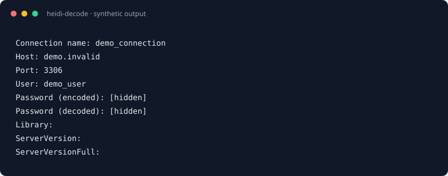

# HeidiSQL Settings Export Parser

[](https://github.com/alsd4git/heidisql-settings-export-parser/actions/workflows/ci.yml)
[](LICENSE)

Parse a HeidiSQL settings export and print its connection settings in a readable
form. The decoder targets the password representation used by HeidiSQL 12.x.

## Security warning

HeidiSQL exports may contain database hosts, usernames, and recoverable
passwords. Both password forms are hidden by default. Use `--show-passwords` only
for authorized recovery: it prints recoverable credentials to stdout and warns
on stderr. Keep exports and revealed output out of Git, logs, issues,
screenshots, and chat transcripts. Even normal output contains private hosts
and usernames.

## Requirements

- Python 3.10 or newer
- [uv](https://docs.astral.sh/uv/)

## Installation

Install directly from the default branch on GitHub:

```bash
uv tool install git+https://github.com/alsd4git/heidisql-settings-export-parser.git
heidi-decode --help
```

For one-off use:

```bash
uvx --from git+https://github.com/alsd4git/heidisql-settings-export-parser.git heidi-decode export_heidi.txt
```

No packaged release has been published yet. Once a release exists, append its tag
to the Git URL, for example `@v0.1.0`, to select that version. The release workflow
builds wheel and source distributions without publishing to PyPI. Record the version
in [CHANGELOG.md](CHANGELOG.md) before pushing a matching tag.

## Quickstart demo

The repository includes a synthetic export with a fake host, user, and password.
It is safe for documentation and testing, but do not use this example as a real
connection. HeidiSQL exports can contain recoverable credentials. Keep real
exports and decoded output out of Git, logs, screenshots, and chat transcripts.

Run the parser on the example:

```bash
uv run heidi-decode examples/synthetic-export.txt
```

The command prints the connection settings with both password forms hidden.
To regenerate the preview below, run
the checked-out parser against the same synthetic export in a temporary working
directory:

```bash
uv run python demos/render_quickstart.py
```



The preview comes from the parser's actual command-line entry point in
[`heidi_decode.py`](heidi_decode.py). The renderer captures stdout and writes a
deterministic SVG. It does not read any HeidiSQL export from your machine.

## Usage

Pass the HeidiSQL export explicitly:

```bash
heidi-decode export_heidi.txt
```

For backward compatibility, omitting the argument still reads
`export_heidi.txt` from the current directory:

```bash
heidi-decode
```

The command prints each connection and the settings it recognizes:

```text
Connection name: dev_db
Host: localhost
Port: 3306
User: dev_user
Password (encoded): [hidden]
Password (decoded): [hidden]
Library:
ServerVersion:
ServerVersionFull:
```

Unknown settings and malformed lines are ignored. Missing fields are printed as
blank values, except that both password fields remain hidden. To reveal them:

```bash
heidi-decode --show-passwords export_heidi.txt
```

The reveal option warns on stderr and prints both password representations to
stdout. Malformed encodings cause an error before any connection is printed.
Validate decoded passwords before relying on them with HeidiSQL
versions other than 12.x.

## Complete example

Given this export:

```text
Servers\dev_db\Host<|||>1<|||>localhost
Servers\dev_db\Port<|||>1<|||>3306
Servers\dev_db\User<|||>1<|||>dev_user
Servers\dev_db\Password<|||>1<|||>6667786172637575797174662
Servers\prod_db\Host<|||>1<|||>prod.host.com
Servers\prod_db\Port<|||>1<|||>5432
Servers\prod_db\User<|||>1<|||>prod_user
Servers\prod_db\Password<|||>1<|||>7375726762736476767a7275673
Servers\prod_db\Library<|||>1<|||>libmariadb.dll
Servers\prod_db\ServerVersion<|||>1<|||>50154
Servers\prod_db\ServerVersionFull<|||>1<|||>5.1.54 - MySQL Community Server
```

the default command prints:

```text
Connection name: dev_db
Host: localhost
Port: 3306
User: dev_user
Password (encoded): [hidden]
Password (decoded): [hidden]
Library:
ServerVersion:
ServerVersionFull:

Connection name: prod_db
Host: prod.host.com
Port: 5432
User: prod_user
Password (encoded): [hidden]
Password (decoded): [hidden]
Library: libmariadb.dll
ServerVersion: 50154
ServerVersionFull: 5.1.54 - MySQL Community Server
```

## Input format

Each line uses this structure:

```text
Servers\<connection name>\<setting><|||><datatype><|||><value>
```

Connection names must not contain a backslash. Settings can include `Host`,
`Port`, `User`, `Password`, `Library`, `ServerVersion`, and
`ServerVersionFull`. HeidiSQL preserves the numeric datatype field, but the
parser does not use it.

## Development

```bash
git clone https://github.com/alsd4git/heidisql-settings-export-parser.git
cd heidisql-settings-export-parser
uv sync --locked --dev
uv run heidi-decode --help
uv run ruff format --check heidi_decode.py tests
uv run ruff check --select E9,F63,F7,F82 heidi_decode.py tests
uv run python -m unittest discover -s tests -v
uv build
```

`uv run heidi_decode.py` remains supported for source checkouts, but the
`heidi-decode` console entry point is the preferred user-facing interface.

Tests run on Linux, macOS, and Windows with Python 3.10–3.15.
Formatting, static checks, and the build/install smoke test run once
on Linux with Python 3.15.

## License

MIT. See [LICENSE](LICENSE).
